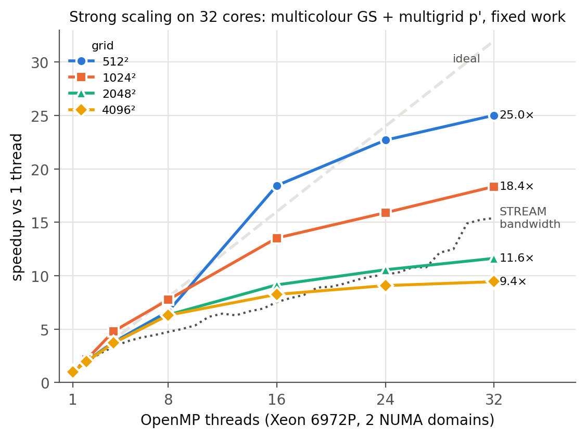

# simple-hpc

A C++17 finite-volume SIMPLE solver for the 2D lid-driven cavity, parallelised with OpenMP and ported to AMD GPUs with HIP. Validated against Ghia et al. (1982); benchmarked on a dual-socket Intel Xeon 6972P node and an AMD MI300A GPU.

- **25×** strong-scaling speedup on 32 cores of a Xeon 6972P node (512²)
- **1.26×** from NUMA-aware first-touch memory placement (4096², 32 threads)
- **2.7×** faster on one MI300A GPU than on 8 CPU cores, same converged solution
- GPU sweep kernels at **91–95 %** of measured device bandwidth (rocprofv3)



Case study: [arfazeli.github.io/simple-hpc.html](https://arfazeli.github.io/simple-hpc.html). Details and all figures: [`docs/RESULTS.md`](docs/RESULTS.md). Numerical method: [`docs/SPEC.md`](docs/SPEC.md).

## Build and test

```bash
cmake -S . -B build -DCMAKE_BUILD_TYPE=Release && cmake --build build -j
ctest --test-dir build -LE ghia      # fast tests; -L ghia runs the validation (needs Python + numpy)
build/simple configs/validation/re1000_128.cfg
```

OpenMP is on by default. GPU backend: add `-DSIMPLE_HIP=ON` (ROCm, default target gfx942). Cluster jobs are in `bench/slurm/`.

## License

MIT
