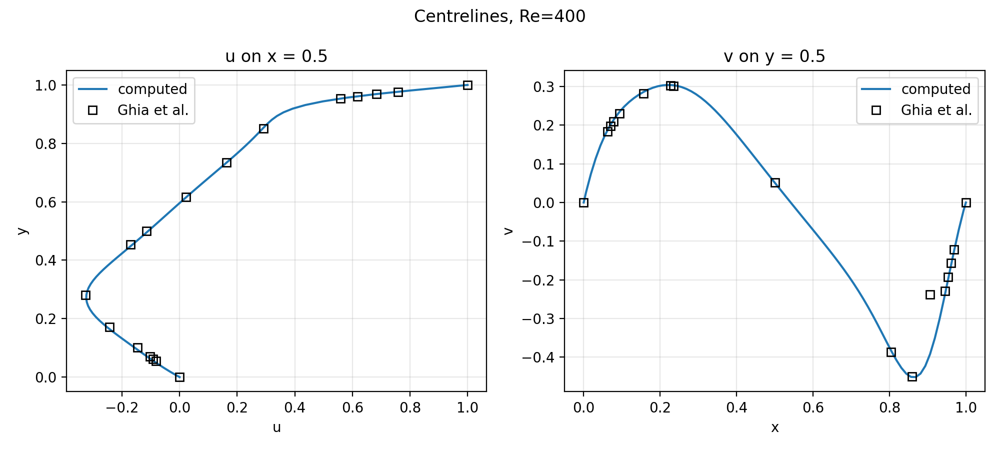
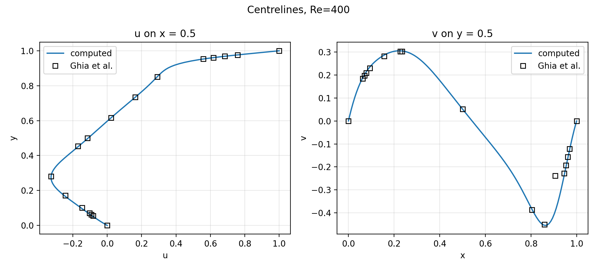
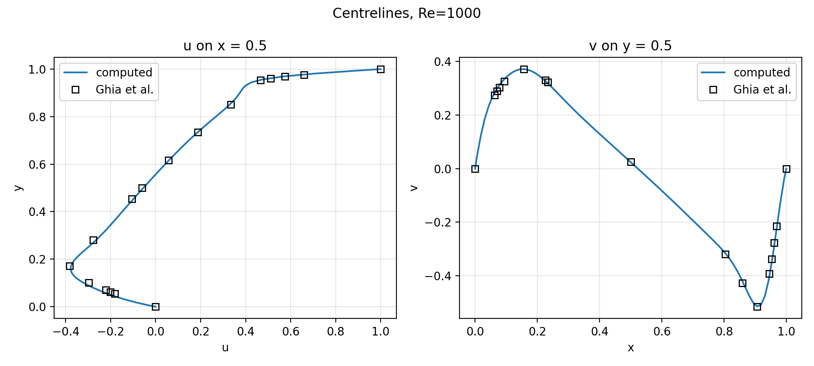
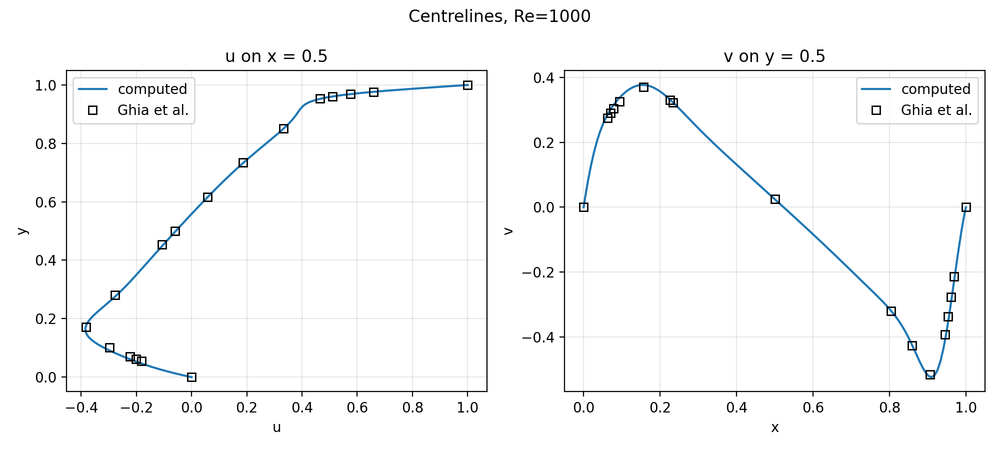
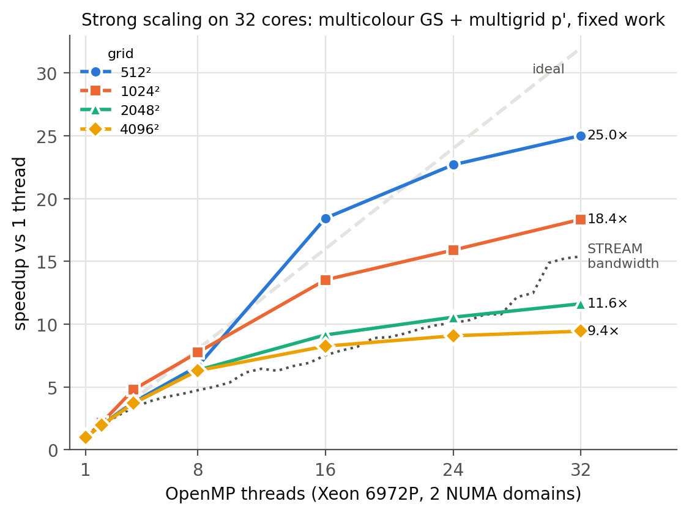

# Results

## Validation against Ghia et al. (1982)

QUICK, `diffusion_order = 4`, `docs/SPEC.md` section 1 defaults, `maxit = 60000`, `error_tolerance = 1e-5`, `residual_normalisation = absolute`. Errors are the RMS and maximum absolute difference between the linearly interpolated centreline and Ghia's 15 interior points (wall points dropped). Configs are in `configs/validation/`; the table is produced by `python3 postprocess/validate_ghia.py results/validation/re* --markdown --keep-suspect`.

| name | Re | NX | iterations | converged | rms_u | max_u | rms_v | max_v |
|---|---|---|---|---|---|---|---|---|
| re1000_128 | 1000 | 128 | 5406 | yes | 0.01257 | 0.02471 | 0.01093 | 0.01862 |
| re1000_80 | 1000 | 80 | 3383 | yes | 0.01698 | 0.03268 | 0.00825 | 0.01386 |
| re400_128 | 400 | 128 | 5566 | yes | 0.00440 | 0.00797 | 0.04000 | 0.15381 |
| re400_80 | 400 | 80 | 2295 | yes | 0.00609 | 0.01110 | 0.03993 | 0.15362 |

All four runs converged. Refining from 80 to 128 cells lowers rms_u at both Reynolds numbers (Re 400: 0.0061 to 0.0044; Re 1000: 0.0170 to 0.0126). At Re 1000 rms_v rises slightly (0.0083 to 0.0109).

 
 

**Note on the Re 400 v data.** Almost all of the Re 400 `rms_v` and `max_v` above comes from one Ghia point, x = 0.9062 (grid index 117), where Ghia lists v = −0.23827. That value breaks the smooth trend of its neighbours (−0.22847 at x = 0.9453, −0.44993 at x = 0.8594), and the solver gives about −0.39 to −0.41 there, so it is likely a misprint in the published table. The data in `postprocess/ghia.py` is left exactly as published. Excluding that single point (the default of `validate_ghia.py`):

| name | rms_v | max_v |
|---|---|---|
| re400_80 | 0.00472 | 0.00882 |
| re400_128 | 0.00496 | 0.00881 |

## Serial baseline

Machine: Apple M3 MacBook Air (fanless; 4 performance + 4 efficiency cores), AppleClang 21.0.0, Release build, 1 thread.
Method: `bench/run_bench.py --repeats 3 --cooldown 3 --tag serial`; square QUICK cavities, Re 1000, fixed 200 iterations, median of 3 repeats run in interleaved order. Data: `bench/results/serial_20261102-1741.csv`. Figures: `figures/performance/phase_breakdown.png`, `figures/performance/throughput.png`.
Phase shares are percentages of the summed time of the six groups (output excluded).

| grid | s/iter | cell updates/s | u-momentum % | u sweeps % | v-momentum % | v sweeps % | p' assembly + corrections % | p' solve % |
|---|---|---|---|---|---|---|---|---|
| 64² | 0.000910 | 4.502e+06 | 12.1 | 33.0 | 11.9 | 19.6 | 1.7 | 21.7 |
| 128² | 0.003756 | 4.362e+06 | 11.0 | 31.0 | 10.6 | 22.7 | 1.6 | 23.2 |
| 256² | 0.015215 | 4.307e+06 | 10.5 | 29.1 | 10.0 | 24.8 | 1.6 | 24.0 |
| 512² | 0.070571 | 3.715e+06 | 10.0 | 34.6 | 9.8 | 19.1 | 1.9 | 24.5 |

## OpenMP: independent kernels

Machine as above; Homebrew GCC 15 (`g++-15`) Release build with OpenMP. Gauss–Seidel sweeps and the p' solve stay serial; assembly, boundary conditions, residuals and corrections run in parallel (`schedule(static)`).
Method: `bench/run_bench.py --exe build-omp/simple --grids 256 512 --threads 1 2 4 8 --repeats 3 --cooldown 3 --tag omp_kernels`; 200 iterations, median of 3, interleaved order. Data: `bench/results/omp_kernels_20261102-1736.csv`. Figure: `figures/performance/speedup.png`.
Speedup = time at 1 thread / time at N threads, same build. Parallelised phases are 27% of the 1-thread time at both grids.
Fields are bit-identical to the snapshots for 1, 2, 4 and 8 threads (`[threads]` test).

| grid | threads | whole iteration | parallelised phases | serial phases | s/iter |
|---|---|---|---|---|---|
| 256² | 1 | 1.00 | 1.00 | 1.00 | 0.013150 |
| 256² | 2 | 1.13 | 1.79 | 1.00 | 0.011745 |
| 256² | 4 | 1.22 | 2.49 | 1.02 | 0.011043 |
| 256² | 8 | 1.15 | 2.28 | 0.98 | 0.011517 |
| 512² | 1 | 1.00 | 1.00 | 1.00 | 0.068816 |
| 512² | 2 | 0.94 | 1.46 | 0.83 | 0.073433 |
| 512² | 4 | 1.03 | 2.15 | 0.86 | 0.067835 |
| 512² | 8 | 0.97 | 2.37 | 0.80 | 0.071578 |

With only 27% of the work parallelised, the whole-iteration speedup is bounded at about 1.35 (Amdahl); 256² reaches 1.22 at 4 threads. At 512² the parallelised phases speed up 2.2–2.4x, but the unchanged serial phases run 14–20% slower once more than one thread is used, so the whole iteration does not speed up. A likely cause (not verified) is cache locality: the coefficient arrays the serial sweeps read were written by other cores, some on the efficiency cluster with its own L2. Parallelising the sweeps (T18) removes this split.

**Timing noise.** This is a fanless laptop that throttles under sustained load. A first run of this benchmark executed all 1-thread runs before all multi-thread runs and reported a 0.6x slowdown at 512²; that was mostly thermal. The runner now interleaves repeats and thread counts and accepts `--cooldown`. Differences under about 15–20% between single runs on this machine are not meaningful.

## Parallel inner solvers

`momentum_solver = jacobi | gs_multicolour` and `pressure_solver = jacobi | gs_redblack` (T18); `gs_lex` stays the default and the snapshots are unchanged. Jacobi copies the field into a scratch array allocated once in `State`, then updates every cell from the copy. Multicolour Gauss–Seidel uses `(i + 3j) mod 5` (5 colours) for the 9-point QUICK/order-4 stencil and `(i + j) mod 2` for UDS with order 2. Red–black is used for p'. There is one `omp for` per colour. p' Jacobi is damped (`pc = 0.8*pc + 0.2*old` after the two-step update). Undamped Jacobi has the checkerboard eigenvalue −1 on the 5-point Neumann operator, so with an even sweep count (default 8) that mode of the mass residual is never corrected and `res_p` stalls (5.8e-3 on 64², Re 400).

**Thread invariance.** For all six combinations below, with QUICK/order 4 and UDS/order 2 on 32×40 and 150 iterations, u, v and p are bit-identical for 1, 2, 4 and 8 threads (`[parallel_solvers]`, g++-15 OpenMP build).

**Outer iterations and agreement with `gs_lex`.** The grid is 32², Re 400, QUICK, order 4, `residual_normalisation = absolute`, `error_tolerance = 1e-9` for every run. Differences are max abs against the `gs_lex/gs_lex` run. p is compared after removing its interior mean, because p is fixed only up to a constant. The raw p differs by up to 1e-3.

| momentum / pressure | outer iterations | u | v | p − mean |
|---|---|---|---|---|
| gs_lex / gs_lex | 1404 | – | – | – |
| jacobi / jacobi | 2369 | 2.5e-09 | 2.5e-09 | 7.6e-10 |
| gs_multicolour / gs_redblack | 1470 | 2.4e-10 | 3.7e-10 | 1.1e-10 |
| gs_multicolour / gs_lex | 1456 | 3.1e-10 | 3.0e-10 | 1.3e-10 |
| gs_lex / gs_redblack | 1423 | 2.0e-10 | 1.9e-10 | 8.1e-11 |
| jacobi / gs_lex | 1598 | 1.1e-09 | 8.6e-10 | 3.9e-10 |
| gs_lex / jacobi | 2186 | 2.8e-09 | 2.8e-09 | 9.0e-10 |

**Ghia, `gs_multicolour / gs_redblack`** (ctests `ghia_re400_80_multicolour`, `ghia_re1000_80_multicolour`, same thresholds). At Re 400 / 80²: 2337 iterations (gs_lex 2295), rms_u 0.00610, rms_v 0.00472 (excluding the suspect Ghia point, as in the ctest). At Re 1000 / 80²: 3718 iterations (gs_lex 3383), rms_u 0.01698, rms_v 0.00825, the same as gs_lex to 5 digits.

Strong-scaling and time-to-convergence benchmarks for these solvers follow in the sections below.

## Pressure-correction solvers

Machine as above; Homebrew GCC 15 (`g++-15`) Release build with OpenMP (`build-omp`). `cg` is Jacobi-preconditioned conjugate gradient on the mean-free p' system, stopping at `||r||/||b|| <= pressure_tolerance` (`pressure_maxit = 1000`).
Method: `bench/run_bench.py --exe build-omp/simple --grids 128 --iters 60000 --repeats 3 --threads 1 4 --cooldown 3 --set error_tolerance=1e-5`, plus `--set pressure_solver=cg --set pressure_tolerance=...` for CG; QUICK, Re 1000, run to convergence (`absolute`, 1e-5); medians of 3. Data: `bench/results/ps_*_128_20261102-*.csv`.
256² was skipped for time (gs_lex alone needs 16570 outer iterations there; CG at 1e-6 would take hours). The 4-thread timings were taken while other tests were running on the same machine, so only the 1-thread times and the iteration counts are reliable.

| grid | p' solver | pressure_tolerance | threads | outer iterations | mean CG iterations | s per outer iteration | total s | converged |
|---|---|---|---|---|---|---|---|---|
| 128² | gs_lex (8 sweeps) | - | 1 | 5406 | - | 0.002865 | 15.5 | yes (n=3) |
| 128² | gs_lex (8 sweeps) | - | 4 | 5406 | - | 0.002851 | 15.4 | yes (n=3) |
| 128² | cg | 1e-2 | 1 | 4230 | 242.1 | 0.010330 | 43.7 | yes (n=3) |
| 128² | cg | 1e-2 | 4 | 4230 | 242.1 | 0.015561 | 65.8 | yes (n=3) |
| 128² | cg | 1e-4 | 1 | 4230 | 422.1 | 0.016818 | 71.1 | yes (n=3) |
| 128² | cg | 1e-4 | 4 | 4230 | 422.1 | 0.026524 | 112.2 | yes (n=3) |
| 128² | cg | 1e-6 | 1 | 4230 | 589.4 | 0.022703 | 96.0 | yes (n=3) |
| 128² | cg | 1e-6 | 4 | 4230 | 589.4 | 0.036934 | 156.2 | yes (n=3) |

Of the three CG tolerances, 1e-2 converges fastest (43.7 s at 1 thread), but that is still 2.8x slower than gs_lex (15.5 s). The outer iteration count is 4230 at all three tolerances, while the mean CG iterations differ (242, 422, 589). The stopping test is bound by res_u, which agrees to 4 digits between 1e-2 and 1e-6 (9.9997e-06 vs 9.9990e-06 at the last iteration).

## Parallel solvers: timing

All runs: Homebrew GCC 15 build with OpenMP, Re 1000, QUICK, order 4, interleaved repeats with `--cooldown 3`, medians, nothing else running on the machine (fanless M3 MacBook Air, 4 performance + 4 efficiency cores). Data: `bench/results/par_*.csv` and `conv_*.csv`. Figures: `figures/performance/parallel/`.

**Time per outer iteration** (200 iterations, median of 3), and speedup against the default solver (`gs_lex` for momentum and p') on 1 thread:

| solver (momentum / p') | grid | 1 thread | 2 | 4 | 8 | best speedup vs gs_lex, 1 thread |
|---|---|---|---|---|---|---|
| gs_lex / gs_lex | 256² | 12.3 ms | 11.2 | 10.1 | 10.5 | 1.22 (4 threads) |
| gs_multicolour / gs_redblack | 256² | 7.4 ms | 4.9 | 4.1 | 4.3 | 2.98 (4) |
| jacobi / jacobi | 256² | 7.0 ms | 4.3 | 3.1 | 3.5 | 3.97 (4) |
| gs_lex / gs_lex | 512² | 51.8 ms | 45.7 | 43.5 | 43.5 | 1.19 (4–8) |
| gs_multicolour / gs_redblack | 512² | 36.5 ms | 25.7 | 21.1 | 20.3 | 2.56 (8) |
| jacobi / jacobi | 512² | 36.0 ms | 24.9 | 18.9 | 14.3 | 3.61 (8) |
| gs_multicolour / cg (tol 1e-2) | 256² | 50.6 ms | 35.1 | 35.4 | 45.8 | 0.35 (2) |

**Time to convergence**, 128², tolerance 1e-5 (absolute residuals), median of 2:

| solver | outer iterations | 1 thread | 4 threads |
|---|---|---|---|
| gs_lex / gs_lex | 5406 | 14.9 s | 13.1 s |
| gs_multicolour / gs_redblack | 5919 | 9.9 s | 8.3 s |

Observations (measured, not explained further):

- The multicolour and Jacobi solvers are already 1.4–1.75x faster than `gs_lex` **on one thread**: lexicographic Gauss–Seidel carries a dependency from each cell to the next along a row, which serialises the arithmetic, while the coloured and Jacobi updates within a pass are independent.
- Jacobi has the cheapest iteration and scales best (3.6x at 8 threads on 512²), but needs about 69% more outer iterations (T18 regression test, 32²), so per converged solution multicolour Gauss–Seidel is the better choice: 1.8x faster to convergence than the default at 128², 4 threads.
- At 512² with 8 threads, the red–black p' solve scales 3.0x over its own 1-thread time, the 5-colour momentum sweeps only 1.4x (each colour touches every fifth cell, so a pass streams the whole array for a fifth of the work).
- Speedups flatten beyond 4 threads, consistent with 4 performance cores and memory bandwidth limits.
- CG for p' is slower per iteration than any other option, and its 4-thread timing is no better than 2 threads; together with the 128² convergence result above (2.8x slower than `gs_lex` at its best tolerance), CG is not competitive inside SIMPLE here.

## Multigrid for p'

`pressure_solver = mg` (SPEC 4.4) runs a geometric V-cycle. Coarse operator: Galerkin with piecewise-constant 2×2 aggregation. Smoother: 2+2 red–black sweeps. Prolongation is over-corrected by `mg_omega`. Build: Homebrew GCC 15 with OpenMP. Data: `bench/results/par_mg_*.csv`, `conv_mg1_*.csv`, `conv_mg2_*.csv`. Linear-solver numbers come from the `[mg]` unit tests.

**Linear solver.** The test system is a realistic p' system (5 outer iterations, Re 1000, QUICK). The table gives the average residual reduction per V-cycle over 10 cycles, starting from p' = 0:

| grid | `mg_omega = 1` | `mg_omega = 1.8` (default) |
|---|---|---|
| 64² (5 levels) | 0.796 | 0.255 |
| 128² (6 levels) | 0.816 | 0.301 |

With `mg_omega = 1`, the factor gets worse as levels are added: at 64² it is 0.59, 0.68, 0.77 and 0.80 for 2 to 5 levels, and the asymptotic factor is 0.885. After 60 cycles the relative residual is still 2.5e-4. The cause is that every coarse link is the sum of two fine links, so in 2D the coarse operator is about 2× stiffer than a rediscretised one. The coarse correction is then about half the needed size, and the shortfall compounds over the levels.

With an exact coarse solve, the step `x += omega P A_c^+ R r` does not increase the A-norm error for 0 < omega ≤ 2: on range(P) the error is multiplied by 1 − omega. omega = 1.8 stays inside that range. With 1.8, the 64² system reaches 1e-8 after 14 cycles and the round-off floor (3e-14) by cycle 60. That solution matches CG at tolerance 1e-12 to 2.3e-14 max abs, where max|p'| is 0.61. A right-hand side with a non-zero mean gives the same p' to 4e-15, because b is projected to mean zero.

**Inside SIMPLE**, with `mg_omega = 1.8` unless stated:
- 32², Re 400, tolerance 1e-9: gs_lex needs 1404 outer iterations, mg_cycles 1 needs 894 and mg_cycles 2 needs 883. The fields agree with gs_lex to 1e-8.
- With `mg_omega = 1`, the same runs need 1049 and 954 iterations, so mg converges even without over-correction.
- 1, 2, 4 and 8 threads give bit-identical u, v and p.
- The Ghia tests at 80² pass (`ghia_re400_80_mg`, `ghia_re1000_80_mg`, gs_multicolour momentum).

**Time per outer iteration** (gs_multicolour momentum, 200 iterations, median of 3, Re 1000). Each cell shows total / p' solve phase per iteration in ms. The gs_redblack rows come from `par_multicolour_*.csv`:

| p' solver | grid | 1 thread | 2 | 4 | 8 |
|---|---|---|---|---|---|
| mg (1 cycle) | 256² | 7.16 / 0.97 | 4.80 / 0.84 | 3.94 / 0.91 | 4.85 / 1.38 |
| gs_redblack (8 sweeps) | 256² | 7.44 / 1.28 | 4.93 / 0.80 | 4.13 / 0.69 | 4.33 / 0.73 |
| mg (1 cycle) | 512² | 34.6 / 4.40 | 25.3 / 2.80 | 20.9 / 2.39 | 20.5 / 2.84 |
| gs_redblack (8 sweeps) | 512² | 36.5 / 6.06 | 25.7 / 3.49 | 21.1 / 2.37 | 20.3 / 1.99 |

**Time to convergence**, 128², Re 1000, tolerance 1e-5 (absolute), median of 2:

| solver (momentum / p') | outer iterations | 1 thread | 4 threads |
|---|---|---|---|
| gs_lex / gs_lex | 5406 | 14.9 s | 13.1 s |
| gs_multicolour / gs_redblack | 5919 | 9.9 s | 8.3 s |
| gs_multicolour / mg, 1 cycle | 4703 | 7.8 s | 7.7 s |
| gs_multicolour / mg, 2 cycles | 4706 | 8.8 s | 9.4 s |
| gs_lex / cg (exact p', T19) | 4230 | – | – |

Observations (measured):

- One V-cycle per outer iteration cuts the outer iterations from 5919 (red–black) to 4703. That closes 72% of the gap to CG's exact-p' count of 4230. A second cycle does not reduce it further (4706).
- On one thread, mg is the fastest p' option to convergence. It reaches the solution in 7.8 s, 1.27× faster than multicolour/red–black and 1.9× faster than the default gs_lex. At 4 threads, mg (7.7 s) and red–black (8.3 s) are within noise.
- One V-cycle costs less than 8 red–black sweeps on one thread (0.97 vs 1.28 ms at 256², 4.4 vs 6.1 ms at 512²), but it barely scales. At 256² the p' phase drops only from 0.97 to 0.91 ms at 4 threads and rises to 1.38 ms at 8. At 128² (conv runs) it takes 0.25 ms on 1 thread and 0.49 ms on 4. This is consistent with each V-cycle having many short parallel regions, while the levels below 64² run serially.
- Per outer iteration the total cost is the same as with red–black within noise at both grids, because the momentum sweeps dominate. The gain from mg comes from fewer outer iterations, not from cheaper ones.

## Fewer copies and parallel regions (T32, T33)

T32 removes the full-field copy that every Jacobi sweep made (one copy per batch, then two alternating buffers). T33 runs each momentum sweep batch in one OpenMP team, makes the O(N) boundary loops serial and merges the three correction loops into one region. Parallel regions per outer iteration for u, v and the correction drop from 20 to 7 (jacobi) and from 18 to 7 (gs_multicolour). All results are bit-identical to the code before T32.

Method: the three builds (before T32 `881eaeb`, T32 `e17153c`, T33 `a84b186`) alternated, rotated order, 3 repeats, `--cooldown 3`, medians; solver time without the field output. 200 outer iterations (2000 at 64²). Data: `bench/results/t3x_*.csv`.

**Time per outer iteration, ms** (before T32 → T32 → T33):

| solver | grid | 1 thread | 4 threads | 8 threads |
|---|---|---|---|---|
| jacobi / jacobi | 64² | 0.404 → 0.385 → 0.388 | 0.678 → 0.542 → 0.457 | 1.232 → 0.937 → 0.809 |
| jacobi / jacobi | 128² | 1.61 → 1.61 → 1.57 | 1.06 → 0.92 → 0.84 | 1.52 → 1.24 → 1.10 |
| jacobi / jacobi | 256² | 6.70 → 6.23 → 6.10 | 2.50 → 2.22 → 2.14 | 2.69 → 2.42 → 2.52 |
| jacobi / jacobi | 512² | 32.8 → 32.2 → 32.3 | 11.2 → 11.0 → 11.2 | 10.3 → 10.2 → 10.2 |
| gs_multicolour / gs_redblack | 64² | 0.436 → 0.432 → 0.435 | 1.048 → 1.082 → 0.879 | 2.03 → 2.09 → 1.82 |
| gs_multicolour / gs_redblack | 128² | 1.76 → 1.75 → 1.75 | 1.45 → 1.41 → 1.25 | 2.50 → 2.28 → 1.95 |
| gs_multicolour / gs_redblack | 512² | 35.3 → 35.1 → 33.7 | 18.6 → 19.7 → 18.3 | 17.7 → 17.9 → 17.5 |

**Time to convergence**, 128², gs_multicolour / mg, tolerance 1e-5 (absolute), 4703 outer iterations in every run, median of 2: 1 thread 7.71 s → 7.84 s (noise), 4 threads 7.47 s → 6.77 s (T33).

Observations (measured):

- The gain is largest where a sweep has little work: jacobi at 64² is 33% faster on 4 threads and 34% on 8; at 128², 21% and 28%. At 512² all three builds agree within noise, so these changes do not move the large-grid limit.
- T32 alone accounts for about half of the jacobi gain at 64² and 128² on 4 threads; its p' phase at 512² is 8% faster on 1 thread (4.06 → 3.75 ms).
- The serial boundary loops and the merged correction region cut the correction phase at 128², 8 threads, from 0.086 to 0.031 ms and the u boundary phase from 0.023 to under 0.001 ms.
- At 64², more threads are still slower than one for both solvers (jacobi 0.39 ms on 1 thread, 0.46 ms on 4); the remaining per-region cost still exceeds the work at this size.
- Time to convergence at 128² on 4 threads improves 9%, more than the 1% spread between repeats; the outer iteration count is unchanged, as expected for bit-identical arithmetic.

## Relaxation tuning (T34)

Outer SIMPLE iterations dominate the cost and grow about 3× per grid doubling, and a better p' solve alone barely reduces them (mg_cycles 2 ≈ 1). T34 tunes the under-relaxation factors and inner sweep counts for `gs_multicolour` + `mg` (config-only; the SPEC defaults stay 0.3 / 0.3 / 0.2). Criterion: running-max residuals < 1e-5, 1 thread, Re 1000, QUICK/4. Data: `bench/results/t34s*_*.csv`.

**Stage 1**, 64², α_u = α_v (default 0.3 / 0.2: 2546 iterations):

| α_u | α_p | outer iterations | seconds | converged |
|---|---|---|---|---|
| 0.3 | 0.2 | 2546 | 1.08 | yes |
| 0.3 | 0.3 | 2445 | 1.05 | yes |
| 0.3 | 0.5 | 2337 | 1.01 | yes |
| 0.3 | 0.7 | 2241 | 0.97 | yes |
| 0.5 | 0.2 | 1307 | 0.57 | yes |
| 0.5 | 0.3 | 1246 | 0.54 | yes |
| 0.5 | 0.5 | 1173 | 0.52 | yes |
| 0.7 | 0.2 | 799 | 0.35 | yes |
| 0.7 | 0.3 | – | 40.19 | no (cap 100000) |
| 0.7 | 0.5 | – | 40.51 | no (cap 100000) |
| 0.8 | 0.2 | – | 41.15 | no (cap 100000) |
| 0.8 | 0.3 | – | 42.60 | no (cap 100000) |
| 0.8 | 0.5 | – | 41.76 | no (cap 100000) |

**Stage 2**, 128² (median of 2): default 0.3/0.2 7572 iterations, 12.4 s; 0.5/0.3 3741, 6.1 s; 0.5/0.5 3522, 5.8 s; 0.6/0.2 2971, 4.9 s; **0.7/0.2 2326, 3.85 s**. With 0.7/0.2, inner sweeps 2 / 4 / 8 and mg_cycles 1 / 2 give 4905 / **2326** / no convergence (1 cycle) and 4790 / 2258 / no convergence (2 cycles); 4 sweeps and 1 cycle is fastest.

**Stage 3**, outer iterations (seconds) against grid size:

| setting | 32² | 64² | 128² | 256² |
|---|---|---|---|---|
| default 0.3 / 0.2 | 1000 (0.10) | 2546 (1.1) | 7572 (12.3) | 24244 (156) |
| 0.7 / 0.2 | diverges (NaN) | 799 (0.35) | 2326 (3.8) | 7497 (48.6) |
| 0.5 / 0.3 | 496 (0.05) | 1246 (0.54) | 3741 (6.1) | not run |

**Validation** (absolute residual < 1e-5, the criterion of the Ghia tests): 0.7/0.2 converges at 80² in 732 iterations (default 2117) and at 128² in 1605 (default 4703, 2.6 s vs 7.8 s). The centreline errors are identical to the default to the printed digits (80²: rms_u 0.01697, rms_v 0.00820; 128²: 0.01255, 0.01090), inside the test limits 0.025 / 0.015: relaxation changes the path, not the converged solution.

Observations (measured):

- α_u = 0.7, α_p = 0.2 cuts outer iterations 3.2–3.3× at 64², 128² and 256², so the gain holds as the grid grows; time to solution drops by the same factor (156 s → 48.6 s at 256²).
- It sits at the edge of stability: at 64² every α_u = 0.8 setting and α_u = 0.7 with α_p ≥ 0.3 fail to converge within 100000 iterations, and at 32² 0.6/0.2, 0.65/0.2 and 0.5/0.5 fail too while 0.7/0.2 diverges to NaN within 400 iterations. 0.5/0.3 converges at every grid tested and still halves the iterations, so it is the robust choice; 0.7/0.2 is for 64² and finer.
- The textbook pairing α_p = 1 − α_u was not best: 0.3/0.7 needs 2241 iterations at 64², 0.5/0.5 is slower than 0.7/0.2 at 128² by 1.5×, and 0.7/0.3 diverges.
- Combined with the earlier changes, 128² to the validation criterion now takes 2.6 s on 1 thread with multigrid and tuned relaxation, against 14.9 s for the original gs_lex solver (5.7×).

## Strong scaling on a 32-core CPU node (T36)

Cluster CPU node, Intel Xeon 6972P, 32 cores of a shared node (`bycore` partition; the job got 8 cores in one SNC NUMA domain and 24 in the next), GCC 12.3, `OMP_PLACES=cores OMP_PROC_BIND=close`, git 452f81c. `gs_multicolour` + `mg`, fixed work (512² × 400, 1024² × 100, 2048² × 25, 4096² × 6 outer iterations), median of 3; repeats agree within 5 % (2048² at 24–32 threads: 9–12 %). STREAM triad with 3 × 1 GiB arrays on the same cores in the same job: 18.6 GB/s on 1 thread, 286 GB/s on 32 (15.4×). The M3 laptop is flat at 86–87 GB/s from 1 thread, which is why its speedups stayed near 1×.

| grid | 1 thread (s/iter) | 8 threads | 16 | 24 | 32 | STREAM ratio at 32 |
|---|---|---|---|---|---|---|
| 512² | 0.061 | 6.7× | 18.4× | 22.7× | **25.0×** | 15.4× |
| 1024² | 0.343 | 7.8× | 13.5× | 15.9× | **18.4×** | 15.4× |
| 2048² | 1.350 | 6.3× | 9.2× | 10.6× | **11.6×** | 15.4× |
| 4096² | 5.227 | 6.3× | 8.3× | 9.1× | **9.5×** | 15.4× |

- **Cache-resident grids beat the bandwidth ceiling.** The 512² working set (about 40 MB) fits in the 32 cores' L2 (2 MB each), so 512² is compute-bound and reaches 25×; 16 threads are superlinear (18.4×) because each thread's share then fits its own L2.
- **Memory-bound grids follow STREAM to 16 threads, then stall.** 4096²: 6.3× at 8 threads (STREAM 4.7×), 8.3× at 16 (7.5×), then 9.5× at 32 while STREAM reaches 15.4×. Cause, confirmed in T37: `Field2D` was zero-filled by the master thread, so every page sat in one NUMA domain and the threads on the other domain read remote memory.
- **Multigrid limits the small grids.** At 512² `solve_p` speeds up only 9.6× (sweeps about 40×) and grows from 14 % to 35 % of the time at 32 threads: the coarse levels have too few cells to keep 32 threads busy (Amdahl).
- The O(N) boundary loops are serial since T33 and stay below 1 % of the time.

## GPU backend on MI300A (T23)

HIP 7.2, one MI300A (gfx942), `gs_multicolour` + `gs_redblack`, fields device-resident, one thread per cell (64×4 blocks), one launch per colour. Each kernel copies the CPU loop body expression for expression with `-ffp-contract=off`.

- **Correctness.** Every phase of the outer iteration is **bit-identical** to the CPU (5-colour and 2-colour cases), and so are u, v, p after 200 outer iterations. Only the residual sums differ in order (fixed-tree block reduction), and they are deterministic run to run. Ghia Re1000 passes at 80² (rms u/v 0.01698/0.00825) and 128² (0.01257/0.01093), with the same iteration counts as the CPU.
- **Speed (single runs, before any GPU tuning).** Re1000 128² to convergence: 2.19 s on the GPU vs 5.83 s on the node's 8 CPU cores (same 5919 iterations). Fixed work: 512² 1.10 ms per outer iteration, 2048² 8.5 ms. At 512² the GPU is launch-bound: about 70 kernel launches and 11 device syncs per iteration.
- Not yet a like-for-like comparison with the T36 CPU numbers, which use the multigrid p' solver. The fair GPU-vs-CPU table (same solver, validated runs) is T25; profiling and tuning is T24.

## NUMA first touch (T37)

`Field2D` now allocates without zeroing and fills its rows in parallel, split like the kernels' descending-i static loops, so each page lands in the NUMA domain of the thread that later uses it. Numerics unchanged (fast tests and snapshots pass on the Mac and on the cluster). Cluster job 26746929: 32 cores, this time **25 in SNC domain 3 and 7 in domain 4**; same job, same cores; median of 3 (spread ≤ 3 %, interleave ≤ 14 %). Speedups relative to the old binary on 1 thread:

| variant | 4096²: 8 thr | 16 | 24 | 32 | 2048²: 32 thr |
|---|---|---|---|---|---|
| old (serial first touch) | 6.4× | 8.8× | 9.5× | 9.6× | 12.3× |
| `numactl --interleave=all`, old binary | 6.0× | 11.1× | 13.1× | **17.7×** | — |
| new (parallel first touch) | 6.4× | 8.8× | 9.5× | **12.1×** | **18.3×** |

- **The mechanism shows up exactly where predicted.** Old and new are identical up to 24 threads, because with `OMP_PROC_BIND=close` threads 0–24 all sit in domain 3, where the master thread had put every page anyway. At 32 threads the 7 threads in domain 4 appear, and only then does first touch help: 1.26× faster at 4096², 1.49× at 2048². In T36 the split was 8 + 24, so the old binary stalled from about 16 threads.
- **Between 16 and 24 threads, the limit is one domain's bandwidth.** STREAM on the same cores plateaus at about 160 GB/s from 19 threads (all in domain 3) and rises to 179 GB/s once domain-4 cores join.
- **Interleaving beats first touch at 16+ threads** (17.7× vs 12.1× at 32) because it spreads pages over all 6 domains' memory controllers, including domains where the job has no cores. On a shared node that borrows other jobs' bandwidth, and it costs 18 % on 1 thread (mostly remote latency). First touch is the placement that stays correct on an exclusive node.
- **Multigrid gains least** (`solve_p` 1.09–1.16× vs sweeps 1.3–1.8×): its level arrays are plain `std::vector`s that are still zero-filled serially. That is the next fix.
- Hardware counters: Granite Rapids rejected the `mem_load_l3_miss_retired.*_dram` event names. The generic `node-load-misses` reports about 200 events for 1e9 loads, which is clearly not remote-DRAM traffic, so there is no counter evidence yet. The right event names come from `perf list` on a compute node.

## NUMA first touch for multigrid (T38)

The `MGWork` level arrays now get the same parallel first touch as `Field2D`, and the 7 multigrid row loops split rows descending, matching the pages of the level-0 fields. Numerics unchanged (fields byte-identical on the Mac; 60/60 fast tests on the cluster). Cluster job 26754956: 32 cores, this time 8 in SNC domain 2 and 24 in domains 4–5; T37 binary (ft) vs T38 binary (mg) in the same job; median of 3. `solve_p` time over the run:

| grid | variant | 1 thr | 16 | 24 | 32 | s/iter at 32 |
|---|---|---|---|---|---|---|
| 4096² (6 it) | ft | 4.57 s | 0.773 | 0.600 | 0.545 | 0.389 |
| | mg | 4.78 s | **0.591** | **0.503** | 0.516 | 0.385 |
| 2048² (25 it) | ft | 4.45 s | 0.566 | 0.465 | 0.425 | 0.0672 |
| | mg | 4.86 s | **0.512** | **0.418** | 0.407 | 0.0673 |

- `solve_p` is 1.19–1.31× faster at 16–24 threads on 4096², 1.11× on 2048². At 32 threads the gain shrinks to 4–6 %, and total time per iteration moves by ≤ 1 %, because `solve_p` is only about 22 % of the iteration there and the job is near this core set's STREAM limit (231 GB/s).
- Cost: `solve_p` on 1 thread is 5–9 % slower (total ≤ 0.7 %). The descending row order is the likely cause; not investigated further.
- No hardware-counter evidence: `perf list` on the compute node returned nothing inside the job, so the local/remote DRAM step was skipped. Dropped rather than chased.

## GPU profile on MI300A (T24 baseline)

rocprofv3 (ROCm 7.2) on one MI300A, `gs_multicolour` + `gs_redblack`, before any GPU tuning. Kernel trace: job 26754980 (2048² × 20 and 512² × 50 outer iterations). Memory counters: job 26761905 (2048² × 3; one counter per pass, since `FETCH_SIZE` + `WRITE_SIZE` together exceed what the hardware can collect at once). Device STREAM in the same allocation (1 GiB arrays): **copy 3890 GB/s, triad 3162 GB/s**.

| kernel (2048²) | time % | µs/launch | MB read | MB written | GB/s (counters) |
|---|---|---|---|---|---|
| `k_sweep_v` (one colour) | 35.2 | 145 | 487 | 27 | 3540 |
| `k_sweep_u` (one colour) | 33.1 | 137 | 476 | 27 | 3680 |
| `k_pc_redblack` (one colour) | 18.3 | 94 | 308 | 35 | 3620 |
| `k_assemble_u` / `_v` | 4.9 | 200–208 | 116–147 | 452 | 2730–3000 |
| `k_residual_u` / `_v` | 3.3 | 134–137 | 500–509 | 0.5 | 3720–3750 |
| all others (11 kernels) | 5.2 | | | | |

- **2048² is bandwidth-bound and already at the bandwidth ceiling.** The GPU is busy 97 % of the 8.47 ms per iteration (74 launches). The three sweep kernels take 87 % of the time and move data at 91–95 % of device STREAM copy. Faster kernels need fewer bytes, not better code.
- **Each colour launch reads every array in full.** A 5-colour sweep updates a fifth of the cells per launch but streams the whole u field and all coefficient arrays each time, so one sweep reads about 5× what it needs. The fix that keeps results bit-identical: store the coefficient arrays colour-major (assembly writes them in that order), so each colour launch reads only its own fifth.
- **Counter caveat.** `FETCH_SIZE` counts L2-miss traffic (128 B requests; it agrees with 2 × 64 × `TCC_EA0_RDREQ_sum`), part of which MI300A's 256 MB Infinity Cache serves before HBM. Writes match the minimum footprint (e.g. `k_correct` writes 105 MB for u, v, p = 3 × 33.6 MB). Reads in the sweeps and residuals are about 2× the arrays they touch, cause not yet pinned down (6 separate XCD L2 caches, unaligned rows). Running `stream_hip` under the same counters calibrates this.
- **512² is latency-bound, not launch-gap-bound.** The GPU is busy 79 % of 0.98 ms per iteration. Each small kernel still takes 5–13 µs, so HIP graphs can recover at most the ~21 % idle time plus the host syncs (wall time is 1.10 ms).
- rocprof-compute's roofline did not run: its Python dependencies (dash, kaleido, textual, …) are not installed on the node. With a few flops per 8-byte value loaded, every kernel sits far left of the ridge point anyway, so the measured GB/s against STREAM is the useful number.
